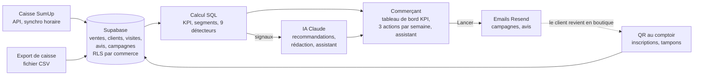

# Embruns — Cahier des charges pour Claude Code

4 novembre 2026 · Elliott Leizé-Degrigny

## 1. Pitch et positionnement

Embruns est l'assistant marketing des commerces de quartier : il transforme les ventes de caisse en clients connus, en KPI clairs et en actions prêtes à lancer en un clic. C'est l'intelligence du back-office Shopify, pour une boulangerie ou un fleuriste.

- **Cible** : commerçants indépendants (boulangerie, fleuriste, caviste, épicerie fine, coiffeur), 1 à 10 salariés, peu digitalisés.
- **Problème** : les ventes sont anonymes, le commerçant ne sait pas qui revient ni qui décroche, les avis Google arrivent au hasard, et il n'a ni le temps ni les outils pour analyser ses chiffres.
- **Promesse** : chaque lundi, savoir ce qui a marché et quoi faire cette semaine, avec l'action déjà préparée.
- **Différenciation** : les cartes de fidélité digitales (FidéliQR, Fidelatoo, Fidiz…) fidélisent. Embruns analyse, recommande et agit.
- **Ligne CV associée** : « AI-powered CRM for local retailers: KPI dashboard, automated insights and one-click marketing actions (customer reviews, follow-ups). »

**Objectif de ce projet** : une démo solide, montrable en 2 minutes à un recruteur ou à un commerçant, sur une boulangerie fictive alimentée par des données réalistes. Tout ce qui est montré doit vraiment fonctionner : aucun écran factice.

## 2. Périmètre de la démo

La démo couvre sept briques. Tout ce qui n'est pas listé ici est hors périmètre, et Claude Code ne doit pas le construire sans demande explicite.

| Inclus | Exclu (V2 ou jamais) |
| --- | --- |
| Espace commerçant : connexion, un commerce | Encaissement : Embruns lit les ventes, il ne les enregistre jamais |
| Inscription client par QR code + carte de fidélité web à tampons | Gestion de stock et inventaire |
| Ventes : import CSV + connecteur SumUp | Apple Wallet / Google Wallet (compte développeur payant) |
| Tableau de bord KPI façon Shopify | SMS (coût à l'envoi) : V2 |
| Avis : demandes automatiques + réponses rédigées par l'IA | API Google Business Profile réelle : avis simulés en V1 |
| Campagnes et automatismes par email | Multi-établissements, rôles et équipes |
| Insights, recommandations IA et actions en un clic, plus un assistant | Abonnement et paiement (Stripe), app mobile native |

Le mode démo (une boulangerie pré-remplie, section 6) fait partie du périmètre : c'est lui qui rend la démo solide.

## 3. Parcours et écrans

Deux utilisateurs : le commerçant (ordinateur et mobile) et son client (mobile uniquement, via le QR code). Le parcours central de la démo est : **recommandation → action en un clic → résultat mesuré**.

**Côté commerçant** (navigation latérale, sobre, inspirée de l'admin Shopify sans la copier)

1. **Accueil** : bandeau de KPI de la semaine comparés à la semaine précédente ; bloc « Vos 3 actions de la semaine » ; fil d'insights ; raccourcis (scanner une carte, nouvelle campagne).
2. **Analyses** : chiffre d'affaires par jour, carte de chaleur jour × heure, top produits, panier moyen, part du CA rattachée à un client connu. Sélecteur 7 j / 30 j / 90 j / 12 mois.
3. **Clients** : liste filtrable par segment (nouveaux, réguliers, VIP, à risque, perdus) ; fiche client avec visites, dépense, tampons, avis, campagnes reçues.
4. **Avis** : note moyenne et évolution, liste des avis, réponse proposée par l'IA, statut (à traiter, répondu).
5. **Campagnes** : liste, création manuelle ou depuis une recommandation, aperçu, envoi, résultats (envois, ouvertures, retours en boutique sous 14 jours). Onglet automatismes.
6. **Assistant** : chat sur les données du commerce.
7. **Réglages** : commerce (nom, logo, couleur, lien vers la fiche Google), programme de fidélité (nombre de tampons, récompense), connexions (SumUp, import CSV), ton de la marque pour l'IA, QR code à imprimer pour le comptoir.
8. **Scanner** (mobile) : le commerçant scanne la carte du client pour ajouter un tampon, ou saisit son numéro.

**Côté client**

1. **Inscription** : scan du QR au comptoir, puis prénom, email ou téléphone, date d'anniversaire facultative, case de consentement marketing non pré-cochée. Moins de 20 secondes.
2. **Carte de fidélité web** : aux couleurs du commerce, tampons, récompense, QR personnel à montrer en caisse. Accessible par un lien unique, ajoutable à l'écran d'accueil.
3. **Emails** : bienvenue, demande d'avis après une visite, campagnes. Toujours avec un lien de désinscription.

**Identité visuelle** : nom Embruns, palette marine (bleu profond + blanc écume + un accent), typographie lisible, beaucoup d'espace. Interface 100 % en français.

## 4. Fonctionnalités détaillées

Chaque module est défini par ses règles métier. Tous les KPI sont calculés en SQL, testés, et comparés à la période précédente de même durée.

### 4.1 Fidélité et identification des clients

- Inscription par QR code, dédoublonnage par email ou téléphone normalisé (un client déjà inscrit retrouve sa carte).
- Un tampon = une visite. Le commerçant scanne la carte (page Scanner) ou saisit le numéro ; un montant facultatif peut être saisi.
- Rapprochement visite ↔ vente : la visite est liée à la vente de caisse la plus proche dans une fenêtre de ± 5 minutes (et de même montant s'il a été saisi). C'est ce lien qui rend les ventes nominatives.
- Récompense après N tampons (réglable, 10 par défaut), puis la carte repart à zéro. Un seul tampon par client toutes les 2 heures, pour éviter les abus.

### 4.2 Segments clients

| Segment | Règle |
| --- | --- |
| Nouveau | Première visite il y a moins de 30 jours |
| Régulier | Au moins 3 visites sur les 90 derniers jours |
| VIP | Top 10 % de la dépense sur 90 jours |
| À risque | Régulier dont la dernière visite date de plus de 2 fois son intervalle médian, et de plus de 21 jours |
| Perdu | Aucune visite depuis plus de 90 jours |

### 4.3 KPI

| KPI | Définition |
| --- | --- |
| Chiffre d'affaires | Somme des ventes TTC sur la période |
| Tickets | Nombre de ventes |
| Panier moyen | CA / tickets |
| CA par créneau | CA par jour de semaine × heure (carte de chaleur) |
| Top produits | Top 10 en CA et en quantité, avec évolution |
| Part identifiée | Part du CA rattachée à un client connu |
| Nouveaux clients | Inscriptions sur la période |
| Taux de retour à 30 jours | Part des nouveaux clients revenus dans les 30 jours |
| Fréquence de visite | Visites moyennes par client actif et par mois |
| Clients à risque | Nombre et CA mensuel associé |
| Note Google | Moyenne et nombre d'avis, évolution sur 90 jours |
| Taux de réponse aux avis | Avis répondus / avis reçus |
| Retour des campagnes | Part des destinataires revenus en boutique sous 14 jours, et CA associé |

### 4.4 Avis

- Demande d'avis par email 1 à 2 heures après une visite, au plus une fois tous les 90 jours par client, envoyée à tous les clients consentants, sans filtrage (section 9).
- Le lien mène directement à la fiche Google du commerce.
- En V1, les avis sont simulés (section 6). Pour chacun, l'IA propose une réponse ; le commerçant la modifie ou la valide, et l'avis passe en « répondu ».

### 4.5 Campagnes et automatismes

- **Automatismes** (activables un par un) : bienvenue après inscription, « vous nous manquez » pour un client à risque, anniversaire, récompense proche (un tampon restant).
- **Campagnes** : un segment, un objet, un message, une offre facultative. Créées à la main ou pré-remplies par une recommandation.
- **Mesure** : une campagne est « gagnante » pour un client s'il revient en boutique dans les 14 jours.
- Canal email uniquement en V1, uniquement vers les clients ayant consenti, toujours avec un lien de désinscription.

## 5. L'IA : insights, recommandations, assistant

Règle d'or : l'IA ne calcule jamais un chiffre. Les KPI et les signaux sont calculés en SQL par du code testé ; l'IA reçoit ces faits, les hiérarchise et rédige. Tout chiffre cité par l'IA doit provenir de ses données d'entrée, et le code le vérifie.

### 5.1 Détection des signaux (déterministe)

Chaque lundi à 6 h, et à la demande, des détecteurs analysent les données. Chaque signal produit un payload chiffré et un impact estimé en euros, pour classer les signaux.

| Détecteur | Déclencheur |
| --- | --- |
| Créneau en baisse | Un créneau jour × demi-journée en baisse de plus de 15 % sur 3 semaines vs les 8 précédentes |
| Réguliers à risque | Au moins 5 clients passent « à risque » |
| Produit en mouvement | Un produit du top 20 varie de plus de 25 % sur 4 semaines |
| Avis à traiter | Avis de 3 étoiles ou moins sans réponse depuis plus de 48 h |
| Note en baisse | Note moyenne des 30 derniers jours inférieure de 0,3 point à celle des 90 jours |
| Part identifiée faible | Moins de 30 % du CA rattaché à un client : pousser l'inscription |
| Récompenses proches | Au moins 10 clients à un tampon de la récompense |
| Campagne à rejouer | Une campagne passée avec un taux de retour supérieur à la moyenne |
| Événement à venir | Un temps fort du calendrier commercial dans les 21 jours (Saint-Valentin, fête des mères, Épiphanie, Noël…), tiré d'un calendrier statique |

### 5.2 Recommandations

- Le modèle reçoit les 5 meilleurs signaux, le type de commerce et son ton de marque. Il renvoie au plus 3 recommandations en JSON validé par un schéma : titre, explication courte avec les chiffres fournis, type d'action (campagne, demande d'avis, réponse à un avis, offre), segment cible, message proposé, impact estimé.
- Exemple attendu : « Le mardi après-midi a perdu 18 % en 3 semaines. Envoyez aux 64 habitués du mardi une offre "Goûter du mardi : -20 % sur les viennoiseries après 15 h". »
- Statuts : proposée, lancée, ignorée. Une recommandation lancée affiche ensuite son résultat (retours en boutique, CA associé).
- Les recommandations de la semaine sont mises en cache : une seule génération par commerce et par semaine, plus une régénération manuelle.

### 5.3 Action en un clic

« Lancer » crée la campagne pré-remplie (segment, objet, message, offre), ouvre l'aperçu, et envoie après une seule confirmation. Pour un avis, « Lancer » ouvre la réponse proposée prête à valider.

### 5.4 Assistant

- Questions en langage naturel : « Quel a été mon meilleur mois ? », « Qui sont mes 20 meilleurs clients ? », « Combien m'a rapporté la campagne de Noël ? ».
- L'assistant utilise uniquement des outils de requête définis dans le code (KPI sur une période, top produits, top clients, ventes par créneau, comptes par segment, résultats d'une campagne). Jamais de SQL libre généré par le modèle.
- Chaque réponse s'appuie sur les résultats des outils ; si la donnée n'existe pas, l'assistant le dit.

### 5.5 Rédaction

Réponses aux avis et messages de campagne, dans le ton réglé par le commerçant (chaleureux, sobre, décalé). Toujours modifiables avant envoi.

### 5.6 Modèles et données envoyées

- API Claude côté serveur uniquement. Modèle configurable par variable d'environnement : un modèle rapide pour la rédaction courte, un modèle plus puissant pour les recommandations et l'assistant.
- Minimisation : le modèle reçoit des agrégats et, au plus, des prénoms. Jamais d'email ni de téléphone.

## 6. Données : modèle et jeu de démo

Tout est dans Postgres (Supabase), chaque table porte un `merchant_id` protégé par une politique RLS. Le jeu de démo est généré par un script déterministe, daté par rapport au jour courant pour que la démo soit toujours « fraîche ».

### 6.1 Tables principales

| Table | Contenu clé |
| --- | --- |
| merchants | nom, type de commerce, logo, couleur, lien avis Google, ton de marque, tampons requis, récompense |
| customers | prénom, email, téléphone, anniversaire, consentement marketing + date, source, date de désinscription |
| loyalty_cards | client, jeton public aléatoire, tampons en cours, récompenses obtenues |
| visits | client, date-heure, montant facultatif, vente rattachée |
| sales | source (csv, sumup, demo), identifiant externe, date-heure, total TTC, moyen de paiement, client rattaché |
| sale_items | vente, produit, catégorie, quantité, prix unitaire |
| reviews | note, texte, auteur, date, réponse, statut, source (demo, google) |
| campaigns | nom, segment, objet, message, offre, statut, recommandation d'origine, dates |
| campaign_sends | campagne, client, envoi, ouverture, visite de retour |
| automations | type, actif, réglages |
| insights | semaine, détecteur, payload, impact estimé |
| recommendations | semaine, signaux sources, titre, explication, type d'action, segment, brouillon, impact, statut |
| integrations | fournisseur, statut, jetons OAuth chiffrés, curseur de synchronisation, dernière synchro |
| import_jobs | fichier, mapping des colonnes, lignes importées, erreurs |
| assistant_messages | historique du chat |

Contraintes : unicité de (merchant_id, source, external_id) sur les ventes pour des imports idempotents ; KPI et segments exposés par des fonctions SQL (`kpi_summary`, `sales_by_slot`, `customer_segments`) appelées par l'app et par l'assistant.

### 6.2 Commerce de démo : « Au Pain Doré », boulangerie-pâtisserie fictive à Toulon

- **12 mois de ventes**, fermée le lundi, environ 250 à 350 tickets par jour, plus le week-end. Pics de 7 h à 9 h, de 12 h à 13 h 30 et de 17 h à 19 h.
- **Une quarantaine de produits** en 5 catégories (pains, viennoiseries, pâtisseries, snacking, boissons), panier moyen autour de 7 €. Saisonnalité : galettes en janvier, bûches en décembre, glaces en été.
- **Environ 650 clients inscrits**, avec une inscription progressive : la part du CA identifiée passe d'environ 5 % à 35 % sur l'année.
- **Environ 180 avis**, note moyenne autour de 4,5, quelques avis négatifs, dont 2 sans réponse.
- **3 campagnes passées** avec leurs résultats (dont une de Noël performante, à rejouer).
- **Scénarios injectés** pour que chaque détecteur ait quelque chose à montrer : mardi après-midi en baisse d'environ 18 % sur les 3 dernières semaines ; une vingtaine de réguliers à risque ; le flan en hausse d'environ 35 % ; plus de 10 clients à un tampon de la récompense.
- **Bouton « Réinitialiser la démo »** : régénère tout en quelques secondes. Les emails du mode démo ne partent jamais vers de vraies adresses (section 7).

Toutes ces valeurs sont des paramètres du script, pas des constantes éparpillées dans le code.

## 7. Intégrations

Toutes les sources de ventes passent par une même interface de connecteur, pour qu'ajouter une caisse plus tard (Zettle, Hiboutik, Square) ne demande qu'un nouveau fichier.

```ts
interface SalesConnector {
  provider: 'sumup' | 'csv' | 'demo'
  fetchSince(cursor: string | null): Promise<{ sales: NormalizedSale[]; nextCursor: string | null }>
}
```

### 7.1 SumUp (vrai connecteur)

- Autorisation OAuth 2 par le commerçant (bouton « Connecter SumUp »), scope de lecture de l'historique des transactions. Jetons chiffrés en base, rafraîchis automatiquement.
- Lecture de l'historique via `GET /v2.1/merchants/{merchant_code}/transactions/history`, synchronisation incrémentale avec le paramètre `changes_since`, pagination par les liens renvoyés. Import idempotent par identifiant externe.
- Synchronisation toutes les heures (tâche planifiée) et à la demande (« Synchroniser maintenant »), avec l'heure de dernière synchro affichée.
- **À vérifier par Claude Code dans la documentation officielle avant d'implémenter** : le détail des produits disponible dans une transaction (sinon, ventes sans lignes produits et KPI produits indisponibles pour cette source) ; les conditions pour qu'une app accède à plusieurs commerçants ; l'existence d'un compte de test.
- En démo : compte de développement SumUp si disponible, sinon le connecteur tourne sur des réponses enregistrées (fixtures) pour montrer le flux complet.

### 7.2 Import CSV (toutes les autres caisses)

- Dépôt du fichier, détection du séparateur et de l'encodage, écran de correspondance des colonnes (date-heure, total TTC, produit, quantité, prix, moyen de paiement), aperçu des 20 premières lignes.
- Modèles de correspondance pré-réglés : export SumUp, export Zettle, format générique.
- Rapport d'import : lignes importées, doublons ignorés, lignes en erreur avec la raison.

### 7.3 Email

- Envoi par Resend (domaine vérifié), modèles en React Email aux couleurs du commerce, lien de désinscription dans chaque message.
- Suivi : envoi, ouverture, désinscription.
- **Mode démo** : aucun email ne part vers les clients fictifs. Ils sont soit redirigés vers une seule adresse de test, soit affichés dans un aperçu intégré.

### 7.4 Avis Google

V1 : avis simulés et lien de dépôt d'avis vers la fiche Google du commerce. V2 : API Google Business Profile, dont l'accès est soumis à validation par Google.

## 8. Architecture technique et stack

Une stack standard et serverless : Next.js sur Vercel, Supabase, l'API Claude et Resend. Le calcul déterministe et l'IA sont deux couches séparées.



Les ventes et les visites alimentent une seule base ; le calcul produit KPI et signaux ; l'IA recommande et rédige ; chaque action lancée est mesurée au retour du client.

| Brique | Choix |
| --- | --- |
| Front et API | Next.js (App Router, TypeScript), Tailwind CSS, shadcn/ui, Recharts |
| Hébergement | Vercel |
| Données et authentification | Supabase : Postgres en région UE, Auth par lien magique, RLS, Storage (logos, fichiers CSV) |
| IA | API Claude via le SDK Anthropic, sorties structurées validées par Zod |
| Email | Resend + React Email |
| Tests | Vitest (KPI, segments, détecteurs, RLS), Playwright (parcours de démo) |

| Tâche planifiée | Fréquence |
| --- | --- |
| Synchronisation SumUp | Toutes les heures |
| Demandes d'avis | Toutes les 15 minutes |
| Automatismes (bienvenue, relances, anniversaires) | Toutes les heures |
| Insights et recommandations | Chaque lundi à 6 h |

Selon le plan Vercel, la fréquence des tâches planifiées peut être limitée : dans ce cas, utiliser pg_cron dans Supabase.

## 9. Règles à respecter

Trois familles de règles, non négociables même en démo : un recruteur ou un commerçant attentif les repère.

**Données personnelles (RGPD)**

- Consentement marketing explicite : case non pré-cochée, horodatée, texte de finalité clair sur la page d'inscription. Sans consentement, le client a sa carte mais ne reçoit aucune campagne.
- Mention d'information sur la page d'inscription : qui traite les données (le commerçant), pourquoi, combien de temps, comment exercer ses droits.
- Lien de désinscription dans chaque email, effectif immédiatement.
- Suppression d'un client depuis sa fiche (droit à l'effacement), avec suppression ou anonymisation de ses données liées.
- Données hébergées dans l'Union européenne (projet Supabase en région UE).

**Avis Google**

- Demander un avis à tous les clients consentants, sans filtrer selon leur satisfaction : Google interdit de ne solliciter que les clients contents.
- Aucune récompense, tampon ou réduction en échange d'un avis.

**Sécurité**

- RLS sur toutes les tables ; un commerçant ne voit jamais les données d'un autre. Tests automatiques de ces politiques.
- Clés d'API et jetons OAuth uniquement côté serveur, jetons chiffrés en base, aucun secret dans le dépôt (`.env.example` seulement).
- Carte client accessible par un jeton aléatoire long, jamais par un identifiant séquentiel ; aucune donnée personnelle dans les URL.
- Limitation du débit sur les pages publiques (inscription, carte) et sur les appels à l'IA.
- Embruns n'encaisse jamais : il lit les ventes. Un logiciel qui enregistre des ventes est soumis en France à des obligations anti-fraude à la TVA.

## 10. Plan de développement

Huit étapes, dans cet ordre. La démo est montrable dès la fin de l'étape 5 ; les étapes 6 à 8 la rendent complète. On ne passe à l'étape suivante que lorsque tous les critères sont cochés.

**Étape 0 — Socle**

- [ ] Projet Next.js (TypeScript) déployé sur Vercel, projet Supabase en région UE, connexion commerçant par lien magique
- [ ] Schéma complet de la section 6 en migrations, RLS active sur toutes les tables, tests d'isolation entre deux commerçants
- [ ] Squelette de navigation (8 écrans vides), identité visuelle de base

**Étape 1 — Données de démo, KPI et Accueil**

- [ ] Script de génération déterministe d'« Au Pain Doré », relatif à la date du jour, bouton de réinitialisation
- [ ] Fonctions SQL des KPI et segments, avec tests unitaires sur un petit jeu de données connu
- [ ] Écrans Accueil (bandeau KPI vs période précédente) et Analyses (graphiques, carte de chaleur, top produits)

**Étape 2 — Clients et fidélité**

- [ ] Page d'inscription par QR, carte de fidélité web, QR à imprimer
- [ ] Page Scanner (tampon par scan ou numéro), règle anti-abus, récompense
- [ ] Rapprochement visite ↔ vente, écran Clients avec segments et fiche client

**Étape 3 — Avis**

- [ ] Écran Avis (note, évolution, liste), demandes d'avis automatiques après visite
- [ ] Réponse proposée par l'IA, modifiable, statut répondu

**Étape 4 — Campagnes et automatismes**

- [ ] Création de campagne par segment, aperçu, envoi par Resend, mode démo sans envoi réel
- [ ] Quatre automatismes (bienvenue, vous nous manquez, anniversaire, récompense proche)
- [ ] Mesure du retour en boutique sous 14 jours

**Étape 5 — Insights, recommandations et action en un clic** (démo montrable)

- [ ] Les 9 détecteurs, testés : chacun se déclenche sur le jeu de démo
- [ ] Recommandations en JSON validé par schéma, vérification que chaque chiffre cité vient des données d'entrée
- [ ] Bloc « Vos 3 actions de la semaine », « Lancer » en un clic, résultat affiché après lancement

**Étape 6 — Import CSV et connecteur SumUp**

- [ ] Import CSV avec correspondance des colonnes, modèles pré-réglés, rapport d'import, imports idempotents
- [ ] Connecteur SumUp : OAuth, synchronisation incrémentale, synchro horaire et manuelle, fixtures pour la démo

**Étape 7 — Assistant**

- [ ] Chat avec outils de requête définis dans le code, réponses chiffrées exactes sur 10 questions de test

**Étape 8 — Finitions de la démo**

- [ ] Parcours e2e Playwright du script de démo (section 11), sans erreur
- [ ] Responsive mobile vérifié (Scanner, inscription, carte), états vides et de chargement soignés
- [ ] Page d'accueil publique Embruns (présentation + bouton « Voir la démo », accès direct sans inscription)

## 11. Script de démo en 2 minutes

Le fil rouge : une boulangerie ne savait rien de ses clients ; en un écran, elle sait quoi faire cette semaine et le fait en un clic. Ce script sert aussi de test de bout en bout (étape 8).

| Temps | Écran | Ce qu'on montre | Phrase clé |
| --- | --- | --- | --- |
| 0:00 | Accueil | Bandeau KPI de la semaine vs la précédente | « Voici ce que voit la boulangère lundi matin. » |
| 0:15 | Accueil | Les 3 actions de la semaine, dont le mardi après-midi en baisse | « Embruns a repéré un créneau qui décroche, et propose quoi faire. » |
| 0:30 | Campagne | « Lancer » : segment, message et offre pré-remplis, envoi | « Un clic, la campagne part vers les bons clients. » |
| 0:45 | Analyses | Carte de chaleur, top produits, flan en hausse | « Ses chiffres de caisse, enfin lisibles. » |
| 1:00 | Clients | Segment « à risque », une fiche client | « Elle sait maintenant qui revient, et qui décroche. » |
| 1:15 | Avis | Avis négatif, réponse proposée par l'IA, validation | « Elle répond à ses avis en 10 secondes. » |
| 1:30 | Téléphone | Scan du QR, inscription, carte de fidélité | « Côté client : 15 secondes au comptoir, sans appli. » |
| 1:45 | Assistant | « Qui sont mes 10 meilleurs clients ? » | « Et elle peut tout demander en français. » |

Conclusion orale : « Les ventes arrivent de la caisse via SumUp ou un fichier ; Embruns les relie aux clients, en tire des KPI et des actions. »

## 12. Consignes pour Claude Code

Ce document est la source de vérité du projet. À placer à la racine du dépôt et à référencer dans `CLAUDE.md`.

1. Lire tout le document avant d'écrire une ligne. Pour chaque étape de la section 10, proposer un plan court, puis l'exécuter.
2. Respecter l'ordre des étapes ; ne passer à la suivante que lorsque ses critères sont cochés et ses tests verts.
3. Tenir à jour un fichier `PROGRESS.md` : étape en cours, critères cochés, décisions prises, points ouverts.
4. Ne rien construire hors périmètre (section 2) sans demande explicite.
5. KPI, segments et détecteurs en SQL ou TypeScript pur, couverts par des tests ; l'IA ne calcule jamais un chiffre (section 5).
6. Avant d'implémenter une API externe (SumUp, Resend, Anthropic, Supabase), vérifier sa documentation officielle actuelle : ces API évoluent. Signaler tout écart avec ce document au lieu de l'ignorer.
7. Aucun secret dans le code : variables d'environnement, `.env.example` à jour.
8. Interface en français ; code, noms de tables et de variables en anglais.
9. Petits commits explicites, un par fonctionnalité.
10. Design sobre et lisible, mobile d'abord pour les pages client et le Scanner, composants réutilisables, états vides et de chargement soignés.
11. En cas de doute sur une règle métier, poser la question plutôt que d'inventer.
